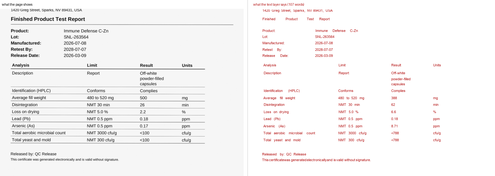
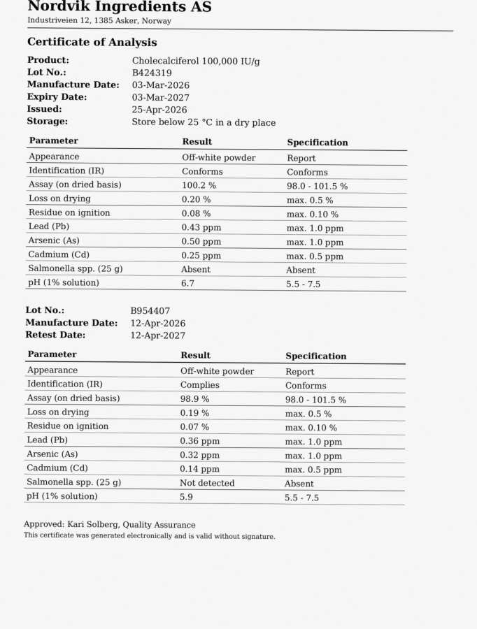
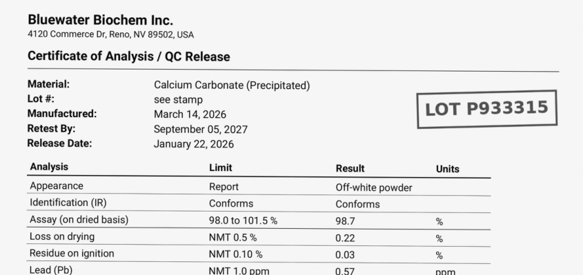
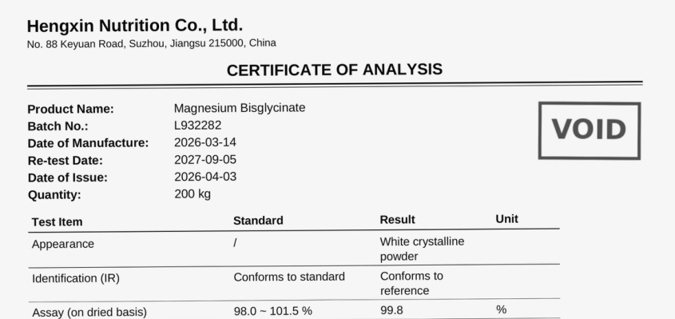

# Task Factory

[](https://github.com/smashbeat/task-factory/actions/workflows/tests.yml)

A generator and a gated pipeline for benchmark tasks that test coding agents on document work.

A task here is a folder of messy business documents and a written policy, graded against an exact answer key. The agent has to build a tool that reads the documents and applies the rules, item by item, with nothing left to interpretation. The factory writes the documents from a seeded model of the domain, computes the answer key from that model and never from a page, checks the task at every stage of its build, and records why each strong agent failed it.

Three packs reached the bar I set: Claude Code on Opus 5.5 and Codex on GPT-6.1 Sol, both at their highest effort setting, fail every run.

## Results

| Pack | What the agent's tool has to read | Codex GPT-6.1 Sol, xhigh | Claude Code Opus 5.5, max |
|---|---|---|---|
| `coa` | supplier certificates of analysis, one PDF each | 19, 11, 20 of 30 | 27, 27, 25 of 30 |
| `size-set` | a vendor's garment measurement report against a brand's graded spec | 13, 19, 18 of 30 | 19, 22, 23 of 30 |
| `lot-release` | a batch release package: an ERP workbook, a CSV, PDFs, emails with attachments | 23, 24, 16 of 30 | 26, 26 of 30 |

A trial is one agent session under the task's own time cap, and its score is the number of hidden items the tool got exactly right. A pass is 30 of 30. Every miss was replayed offline from the agent's saved program and traced to a numbered rule in the policy or to a page the program misread. The pilot logs in `docs/` hold that attribution item by item. A fourth pack, radio packet captures, was dropped when a cheaper model passed its screen.

The runs cost about $2 per Codex trial and, by Harbor's estimate, between $10 and $50 of subscription usage per Opus trial.

## What the agent sees



The page on the left is what a reader sees. On the right, every word the PDF's text layer holds, drawn at its own position. The layer was planted: loss on drying reads 2.2 on the page and 6.6 in the layer, the fill weight 500 and 388. A tool that trusts the text layer rejects a good batch. The policy says the printed page is the truth.

| | |
|---|---|
|  |   |
| One certificate, two lots, each with its own table. The batch used the second one. This page beat every run of every agent. | A lot number that exists only as a stamp, and a VOID stamp on a scan that voids the whole certificate. Both read fine to a person. |

## What makes a task hard without being unfair

The first pack was written by hand. Watching two frontier agents fail it showed five mechanisms, and each one carries to a new domain:

- **A cheap channel that lies.** A scanned page carries a text layer that disagrees with the pixels. A cell's stored number disagrees with its displayed format. An email's words disagree with its attachment. The policy says which one is true.
- **The agent has to build a reader.** A handful of worked samples and thirty hidden items, in several house styles and production routes. Patching a parser never converges. The agent has to write reading code that holds up.
- **Stacking.** Four to six traps per hidden item, graded all or nothing.
- **Supersession.** A revision page, a stamp or an email reply changes a value. The later value wins, and the policy says how to tell which is later.
- **Exactness by house rules.** Rounding and units follow the policy to the digit. The truth comes from the generator's data, never from reading a document back.

What keeps it fair is checked, not asserted:

- The rules are data. The policy text is produced from the same source as the test assertions and the worked samples, so they cannot drift apart.
- Every trap appears in at least one worked sample.
- The reference solution passes every item on fresh seeds. The empty solution scores zero.
- The verifier grades without a model and ignores formatting.
- Every failed trial is attributed. A failure that no written rule explains sends the task back to its spec.

## How it works

A **pack** describes one domain. `packs/` holds four. Each one carries:

- a data model and a truth engine
- the rules, as data, each with the fields it decides
- the traps, each tied to the rule it exercises and to the signature its violation leaves in a diff
- the house styles and a renderer to clean documents

A **forge** takes a clean rendering and makes it look like production:

- `docforge`, for PDFs: born-digital, distilled, outlined, scanned with a right, wrong or missing text layer, rotated, form-filled; overlays for stamps, watermarks and annotations. Ghostscript, OCRmyPDF and pikepdf do the work.
- `office`, for the rest: workbooks with hidden rows and format lies, CSV exports, email threads with attachments.

The **builder** plans a corpus for a seed so every trap shows in a sample, draws the composition of each hidden item at random, computes the truth, renders, runs the reference in Docker, holds out a fresh seed and assembles a [Harbor](https://github.com/harbor-framework/harbor) task directory. Each stage has a gate, and a failed gate names the stage the task goes back to.

| Stage | Gate |
|---|---|
| pack | every trap cites a rule the pack states, every rule is exercised by some trap, and every trap can be built on some route and style |
| spec | every trap shows in a worked sample, and the samples stay under the task's cap |
| corpus | hidden items spread over enough house styles to resist fingerprinting; every trap and every rule decides at least one hidden item |
| render | every item drawn, and drawing changed no answer |
| reference | the reference passes every item within the time limit on the build seed, then on a holdout seed it never saw |
| screen | a mid-tier agent under a short cap fails |
| frontier | one trial per model family fails; more runs only after both do |
| attribution | every miss replays offline and traces to a rule or a page |

The last three stages run by hand with `scripts/trials/`; the first five run inside `taskfactory build`.

The **check** command reads a finished task's evidence (manifest, trials, static checks, rubric runs) and reports each gate with its findings. It reproduced the hand-made failure table of the first task exactly.

## Repository

```
src/taskfactory/
  builder/        plan, items, render, reference, holdout, assemble, gates, authoring agent
  forge/          docforge (PDF routes and overlays), office (xlsx, csv, eml), coa document library
  attribution.py  classify each verifier diff: rule-decided, reading, unexplained
  gates.py        the four gates over a finished task's evidence pack
packs/            coa, size-set, lot-release, packet-log: model, rules, traps, renderer, task tree
scripts/trials/   Harbor runs, offline replay and page inspection
docs/             design notes and the pilot log of every build and trial
tests/            unit tests; render and reference tests run only with the packs' Docker images
```

## Run it

```bash
uv venv -p 3.13 && uv pip install -e '.[dev]'
uv run pytest                                             # 144 tests; 48 more need Docker
uv run taskfactory build packs/lot-release --seed 1 --out out/build-lot-1 --docker
scripts/trials/harbor_task.sh out/build-lot-1/task/lot-release-s1 out/jobs oracle-1
scripts/trials/harbor_task.sh out/build-lot-1/task/lot-release-s1 out/jobs nop-1 --agent nop
CLAUDE_CODE_OAUTH_TOKEN=... scripts/trials/frontier_chain.sh out/build-lot-1/task/lot-release-s1 out/jobs codex-1 opus-1
scripts/trials/replay_agent.sh out/jobs/codex-1/lot-release-s1__* out/build-lot-1 h09 h11
```

Building needs Docker; the packs carry their generator and reference images. The trials need the Harbor CLI and a login for each agent.

## What I learned

- Clean computation does not beat these agents. My first four task ideas were well-specified calculations, and both agents solved each of them, most in under 20 minutes. The tasks that held were the ones where reading is the work.
- A generator can be fingerprinted. One agent recognised the generator from its single layout and its producer string, then rebuilt it and solved the task. Several house styles and real producer strings closed that door, along with fonts the container lacks.
- The same two traps beat every run of the last pack: a certificate that reports two lots on one page with the batch's lot second, and a lot number that exists only as a stamp. Each agent's reading strategy trades one weakness for another. The run that trusted text layers was lied to; the run that ignored them lost clean text.
- An agent's finished program is deterministic. Replaying it offline reproduced every verifier failure exactly, so attribution is read from the program and the page, with no model in the loop.
- A rubric that reads the task text is good at quality and weak at fairness and difficulty. Difficulty is only measured by running agents. Fairness is only judged on the failures.

## How it was built

I designed the factory, wrote the rules of each domain from work I have done, and made the fairness rulings. Claude Code wrote most of the code, under tests and gates; the commit trail shows the work, and the design notes in `docs/` are the drafts I built from. The agent that built the factory is one of the two the tasks measure.

## Status

Three packs at the bar and one dropped, built between 2026-10-30 and 2026-11-06. Not built yet: the spec gate's ambiguity probe across model families, the generator fingerprint audit as a gate, verifier mutation, checkpointed frontier trials that stop a run already passing, and a calibrated judge for the unexplained residue. Publishing the generators means a task's value is in fresh seeds and withheld hidden sets, not in the seeds here.
